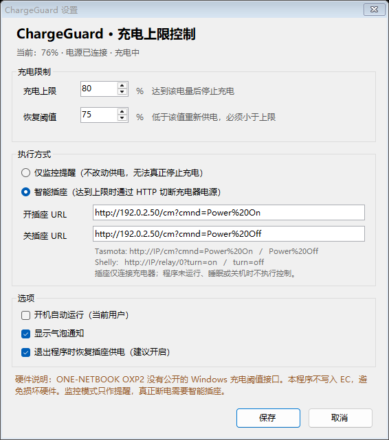
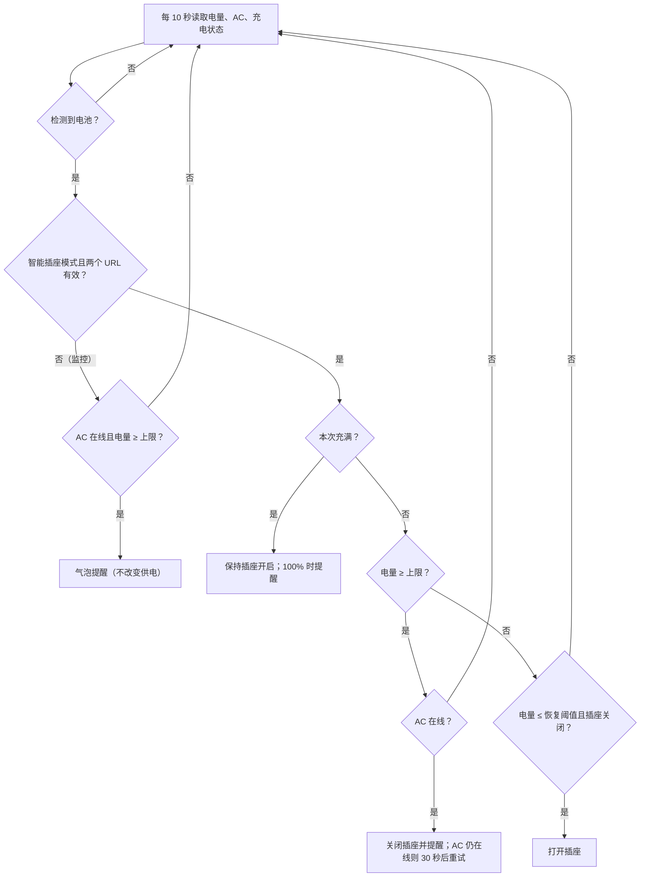

# ChargeGuard

> **English summary:** ChargeGuard is a small Windows tray app for the ONEXPLAYER 2 handheld. The device exposes no Windows charge-threshold API, so the app either notifies you at an adjustable limit or switches a Wi-Fi smart plug over HTTP to physically stop the charger. It never writes to the EC/firmware. It includes a 68-test self-check, hysteresis, a one-shot “charge to full” override, and an optional smart-plug recovery action.


给 **ONE-NETBOOK ONEXPLAYER 2（OXP2 / ARP23）** 用的充电上限托盘工具：上限可调（默认 80%）、恢复阈值可调（默认 75%）、“充满（本次）”临时覆盖，并可通过智能插座真正切断充电器供电。



> 截图为程序生成的固定演示状态（76% 电量、示例 URL），不读取使用者的真实电池或配置。

---

## 重要：它不能直接给电池设阈值

**OXP2 的 Windows 没有可用的充电阈值接口。** 这不是界面没做，而是硬件/驱动层没有暴露出来。ChargeGuard 因此提供两种模式：

| 模式 | 能否真正停止充电 | 适用场景 |
| --- | --- | --- |
| **监控提醒**（默认） | 否 | 没有智能插座；到上限弹一次通知，提醒你拔电 |
| **智能插座** | 是 | 充电器接在可 HTTP 控制的插座上；到上限关闭插座 |

程序**不会**写入 EC、不会安装驱动、不会要求管理员权限。它是一个外部开关控制器，不是固件或电池改装。

### 判断依据

以下是 2026-10 在 OXP2 上做的只读探测与公开资料核对，目的是确认“有没有标准办法”，而不是绕过保护：

- 通过 SetupAPI 枚举电池设备，找到 `SR Real Battery`；对 `IOCTL_BATTERY_QUERY_INFORMATION` 返回的 `BATTERY_INFORMATION` 读取到 `Capabilities = 0x80000000`，即 `ChargeSupported=False`、`DischargeSupported=False`。Windows 标准电池接口不支持启停充电。
- Windows 电源管理没有通用的“充电上限”API。ACPI 的 `_BTP` 是电量跳变通知机制，不是充电停止控制器。
- Linux `oxpec` 驱动里确实存在充电限制寄存器（`0xA3`）和旁路寄存器（`0xA4`），但其声明支持的机型是 X1 / G1 / OneXFly 等，**OXP2 被明确排除**；HHD/Adjustor 的 Linux 电池插件也走 sysfs，不适用于 Windows。
- 测试时安装的 OneXConsole 0.6.4 未包含充电阈值功能；厂商后续在部分新机型上提供了类似能力，但不在 OXP2 上。
- 机器上存在 WinRing0 / iqvw64 等端口 I/O 组件，但 OXP2 的 EC 寄存器语义没有公开、可验证的文档。向未知寄存器写值可能造成不可逆的硬件或 EC 状态问题，所以本项目刻意不碰。

如果你确认并愿意承担实验性 EC 写入的风险，可以自行 fork 研究；上游默认版本不会加入这类操作。

---

## 目录

- [功能](#功能)
- [工作方式](#工作方式)
- [系统要求](#系统要求)
- [快速开始](#快速开始)
- [智能插座配置](#智能插座配置)
- [托盘菜单](#托盘菜单)
- [设置项](#设置项)
- [配置文件](#配置文件)
- [命令行](#命令行)
- [开机自启与文件位置](#开机自启与文件位置)
- [安全与隐私](#安全与隐私)
- [已知限制](#已知限制)
- [故障排查](#故障排查)
- [常见问题](#常见问题)
- [从源码构建](#从源码构建)
- [项目结构](#项目结构)
- [测试](#测试)
- [卸载](#卸载)
- [版本历史](#版本历史)
- [贡献](#贡献)
- [许可与致谢](#许可与致谢)

---

## 功能

- **可调上限**：`50–100%`，默认 80%。
- **可调恢复阈值**：`40–99%`，默认 75%；必须低于上限。
- **回差控制**：到上限关闭插座，降到恢复阈值才重新打开；中间区间保持现状，避免继电器反复动作。
- **两种执行方式**：只提醒，或通过 HTTP GET 控制智能插座。
- **本次充满**：临时绕过限制，保持插座供电直到 100%；可随时手动恢复限制。
- **自动取消覆盖**：拔掉充电器、程序重启都会取消“本次充满”，避免限制被永久绕过。
- **失败重试**：插座请求失败会按冷却时间重试，并节流提示（60 秒一次）。
- **断开检测**：插座已关闭但 Windows 仍报告 AC 在线时，30 秒后重发关闭命令。
- **退出恢复**：正常退出时默认把插座重新打开（可关闭）。
- **托盘状态**：动态电池图标、电量/AC/充电状态、最近一次动作、本次充满标记。
- **开机自启**：当前用户级 `HKCU\...\Run`，不安装服务。
- **日志与配置持久化**：自动保存插座开关和覆盖状态，日志按大小轮转。
- **单实例**：重复启动会提示已在运行，不会出现两个托盘图标。
- **零外部依赖**：单个 exe，无需安装运行时（Windows 10/11 自带 .NET Framework 4.8）。

---

## 工作方式

程序每 **10 秒**读取一次 `GetSystemPowerStatus`（电量、AC 是否在线、是否在充电），然后按下面的逻辑执行：



### 行为细节

| 场景 | 行为 |
| --- | --- |
| 监控模式，到上限且 AC 在线 | 只弹通知；电量降到 `上限 - 2` 以下后重新武装 |
| 插座模式，到上限且 AC 在线 | 关闭插座；10 秒冷却后仍未断电则继续处理 |
| 插座已关闭，AC 仍在线 | 每 30 秒重发一次关闭，处理状态不同步 |
| 插座已关闭，电量 ≤ 恢复阈值 | 打开插座；10 秒冷却，避免连续请求 |
| 恢复阈值 < 电量 < 上限 | 保持当前插座状态（回差） |
| 本次充满 | 保持/打开插座；到 100% 提醒；外部断电或程序重启取消 |
| 上限 = 100% | 永不主动关闭插座（等于关闭限制） |
| 无电池 / 状态未知 | 不做任何动作 |
| AC 已断开 | 不发送关闭命令，因为已经没有充电可切断 |

关于“本次充满”：

- 点击托盘菜单 **充满（本次）** 后，`Override=True`，会写入配置。
- 如果插座当前是关闭的，程序会立即请求打开。
- 到 100% 后只提醒，不会自动恢复限制；需要点击 **恢复 X% 限制**，或在下次启动前保持覆盖。
- 拔掉充电器、重启程序会自动清除覆盖。

### 失败的语义

程序判断插座命令成功与否的依据是 HTTP 状态码 **200–399**。网络错误、超时（5 秒）、4xx/5xx 都算失败：

- 失败不会把 `PlugOff` 标成已关闭。
- 失败后按冷却时间重试；错误通知 60 秒内最多一次。
- 如果插座确实断了但请求超时，程序仍认为失败，会在下一次重试；以实际插座状态为准。
- 智能插座断网时程序无法替你断电，这是外部控制方案的固有限制。

---

## 系统要求

| 项目 | 要求 |
| --- | --- |
| 系统 | Windows 10 / 11（x64 实测） |
| 运行时 | .NET Framework 4.8（Windows 10 1903+ / Windows 11 自带） |
| 权限 | 普通用户即可；不需要管理员 |
| 硬件 | 能读取电池状态的 Windows 设备；OXP2 已测试 |
| 可选 | 支持 HTTP GET 开关的智能插座 / 继电器 / Home Assistant |

> 其他 Windows 掌机或笔记本也可以运行监控模式；智能插座模式不依赖机型。但 UI 和硬件说明针对 OXP2。

---

## 快速开始

### 方式 A：使用发布包

1. 打开 GitHub 的 **Releases**，下载 `ChargeGuard-v1.0.0-win.zip`。
2. 解压到一个固定目录（例如 `D:\Tools\ChargeGuard`）。
3. 双击 `ChargeGuard.exe`。它没有主窗口，图标在任务栏通知区域（可能被折叠到 `^` 里）。
4. 右键图标 → **设置...**。
5. 只想被提醒：保持“仅监控提醒”。
6. 想真正限充：选“智能插座”，填入开/关 URL，保存。
7. 需要临时充满：右键 → **充满（本次）**。
8. 需要开机运行：设置里勾选“开机自动运行（当前用户）”。

> exe 未做代码签名，Windows SmartScreen 可能提示“未知发布者”。这是开源小工具的常见情况；可以自行审查源码并用 `build.cmd` 重建，或只运行你信任的构建产物。

### 方式 B：从源码构建

见[从源码构建](#从源码构建)。构建输出在 `dist\ChargeGuard.exe`。

### 第一次验证建议

1. 只把**充电器**接到智能插座上，插座上不要接其他设备。
2. 先用插座自己的 App 或浏览器测试开/关 URL，确认插座会动作。
3. 把上限设为略低于当前电量，确认 AC 在线，保存设置。
4. 等待 10–20 秒，观察插座是否关闭并出现通知。
5. 点击 **充满（本次）** 或 **恢复插座供电**，确认插座重新打开。
6. 验证完成后把上限改回 80%。

> 不要用 ChargeGuard 控制路由器、显示器、外置硬盘或其他重要设备的供电。

---

## 智能插座配置

程序对配置的两个 URL 发送普通 **HTTP GET**：

- 两个地址必须分别以 `http://` 或 `https://` 开头。
- 返回状态码 2xx / 3xx 视为成功；5 秒超时。
- 不发送 `Authorization` 头，不支持 POST、PUT 或自定义请求体。
- 不走系统代理（避免局域网请求被代理拦截）。
- 地址保存为明文；不要把长期有效的密钥直接放在 URL 里而不加保护。
- 本文档用 `192.0.2.50` 作为示例地址。它属于 RFC 5737 的文档保留网段，不可路由；请替换成你的插座实际 IP。

### Tasmota

```text
开：http://192.0.2.50/cm?cmnd=Power%20On
关：http://192.0.2.50/cm?cmnd=Power%20Off
```

- `%20` 是空格，不能省略。
- 如果启用了 Web 密码，本程序无法发送认证头。建议用 Home Assistant 转发，或使用允许局域网匿名控制的最小权限配置。

### Shelly Gen1

```text
开：http://192.0.2.50/relay/0?turn=on
关：http://192.0.2.50/relay/0?turn=off
```

### Shelly Gen2 / Gen3

```text
开：http://192.0.2.50/rpc/Switch.Set?id=0&on=true
关：http://192.0.2.50/rpc/Switch.Set?id=0&on=false
```

### Home Assistant Webhook

本程序只发 GET，所以 webhook 必须允许 GET。配置两个自动化：

```yaml
automation:
  - alias: ChargeGuard charger on
    trigger:
      - platform: webhook
        webhook_id: chargeguard_on
        allowed_methods: [GET]
    action:
      - service: switch.turn_on
        target:
          entity_id: switch.charger

  - alias: ChargeGuard charger off
    trigger:
      - platform: webhook
        webhook_id: chargeguard_off
        allowed_methods: [GET]
    action:
      - service: switch.turn_off
        target:
          entity_id: switch.charger
```

对应地址：

```text
开：http://HA_IP:8123/api/webhook/chargeguard_on
关：http://HA_IP:8123/api/webhook/chargeguard_off
```

`webhook_id` 本身相当于访问凭据，不要公开；不要把 Home Assistant 直接暴露到公网。

### 其他设备

任何满足以下条件的设备都可以用：

- 有一个 URL 能通过 GET 打开负载；
- 有一个 URL 能通过 GET 关闭负载；
- 返回 2xx / 3xx，响应体不重要；
- 插座只给充电器供电。

如果设备需要认证或 POST，建议在 Home Assistant 里封装成允许 GET 的 webhook，再由 HA 调用设备。

### 插座状态与程序状态不同步怎么办？

程序只根据 HTTP 结果和 Windows 的 AC 状态推断插座状态。可能出现：

- 插座断电后 Windows 仍短暂显示 AC 在线：30 秒后会重发关闭。
- 你在插座 App 里手动关了插座：程序不知道；点 **恢复插座供电** 可以强制打开。
- 你在插座 App 里手动开了插座而程序认为已关闭：如果电量仍 ≥ 上限且 AC 在线，30 秒内会再次关闭；想临时充满请点 **充满（本次）**。
- 程序被强制结束：插座可能留在关闭状态。下次启动不会自动清空 `PlugOff`；点 **恢复插座供电**，或让电量降到恢复阈值。

---

## 托盘菜单

右键电池图标：

| 菜单项 | 说明 |
| --- | --- |
| 当前状态 | 只读：电量、AC、充电、插座状态 |
| 最近动作 | 只读：最近一次成功/失败的动作和时间 |
| 充满（本次） | 临时取消上限；如果插座关着会先打开 |
| 恢复 X% 限制 | 清除覆盖；高于上限时会在下一次检查中关闭插座 |
| 恢复插座供电 | 强制发送开插座请求，用于插座误关或切换配置后的恢复 |
| 立即检查 | 立刻读取并执行一次状态机，不用等 10 秒 |
| 设置... | 打开设置窗口 |
| 打开日志 | 用记事本打开日志 |
| 使用说明... | 打开本 README |
| 退出 | 停止程序；默认先恢复插座供电 |

双击图标也可以打开设置。

---

## 设置项

| 设置 | 范围 / 默认 | 说明 |
| --- | --- | --- |
| 充电上限 | 50–100，默认 80 | 达到或超过该电量时切断插座；100 表示关闭限制 |
| 恢复阈值 | 40–99，默认 75 | 低于或等于该值时重新供电；必须小于上限 |
| 仅监控提醒 | 默认 | 不做供电控制，只通知 |
| 智能插座 | 可选 | 两个 URL 都有效时才生效，否则自动退回监控 |
| 开插座 URL | http(s) | 发送 GET 打开充电器供电 |
| 关插座 URL | http(s) | 发送 GET 切断充电器供电 |
| 开机自动运行 | 默认关 | 写入当前用户 Run 键 |
| 显示气泡通知 | 默认开 | 到上限、充满、失败时提示 |
| 退出时恢复插座供电 | 默认开 | 正常退出时如果插座关闭则发送打开请求 |

保存智能插座模式时会弹一次确认框，提醒你确认插座上只接充电器。这是有意的安全确认。

---

## 配置文件

路径：

```text
%APPDATA%\ChargeGuard\config.ini
```

日志：

```text
%APPDATA%\ChargeGuard\chargeguard.log
```

日志约 1 MB 轮转到 `chargeguard.log.old`，只保留一份旧日志。内容是时间戳、动作、HTTP 状态、错误信息，不包含账号密码。

配置示例见仓库根目录的 [`config.example.ini`](config.example.ini)。手工修改前请先退出程序，否则内存中的状态可能覆盖文件。

| 键 | 取值 | 默认 | 说明 |
| --- | --- | --- | --- |
| `Limit` | 50–100 | 80 | 充电上限 |
| `Resume` | 40–99，且 `< Limit` | 75 | 恢复阈值 |
| `Mode` | `Monitor` / `SmartPlug` | `Monitor` | 执行方式 |
| `PlugOnUrl` | http(s) URL | 空 | 开插座 |
| `PlugOffUrl` | http(s) URL | 空 | 关插座 |
| `Autostart` | `True` / `False` | `False` | 开机启动 |
| `Notifications` | `True` / `False` | `True` | 气泡通知 |
| `RestoreOnExit` | `True` / `False` | `True` | 正常退出恢复插座 |
| `Override` | `True` / `False` | `False` | “本次充满”运行状态；启动时自动清除 |
| `PlugOff` | `True` / `False` | `False` | 程序认为插座已关闭；自动维护 |

解析规则：

- 键名大小写不敏感；节名会被忽略。
- 布尔值接受 `true/false`、`1/0`、`yes/no`、`on/off`。
- 超出范围的值会被限制到边界；`Resume >= Limit` 时会自动降到 `Limit - 5`（最低 40）。
- 无效或空的 URL 会让智能插座模式退回监控。

恢复默认：退出程序，删除 `config.ini`，重新启动。

---

## 命令行

| 命令 | 说明 |
| --- | --- |
| `ChargeGuard.exe` | 启动托盘程序 |
| `ChargeGuard.exe --tray` | 启动托盘程序 |
| `ChargeGuard.exe --status` | 打印电池、配置和运行状态 |
| `ChargeGuard.exe --selftest` | 运行 68 项内置自检，返回码 0/1 |
| `ChargeGuard.exe --screenshot [路径]` | 生成固定的设置界面演示截图 |
| `ChargeGuard.exe --help` | 显示帮助 |

`--status` 示例（数值仅作格式演示）：

```text
ChargeGuard status
------------------
config:    %APPDATA%\ChargeGuard\config.ini
log:       %APPDATA%\ChargeGuard\chargeguard.log
battery:   87% · 电源已连接
raw:       percent=87 ac=True charging=True hasBattery=True unknown=False
mode:      SmartPlug (plug active)
threshold: limit=80% resume=75%
state:     override=False plugOff=False autostart=False
url on:    http://192.0.2.50/cm?cmnd=Power%20On
url off:   http://192.0.2.50/cm?cmnd=Power%20Off
```

程序是 Windows GUI 子系统（双击不会闪黑框）。在控制台运行时会把输出附加到父控制台；没有可用控制台时，同时写入：

```text
%TEMP%\chargeguard_cli.txt
```

自检不访问网络，也不会操作真实插座；插座 HTTP 路径的验证见[测试](#测试)。

---

## 开机自启与文件位置

自启使用当前用户注册表，不需要管理员：

```text
HKCU\Software\Microsoft\Windows\CurrentVersion\Run
值名：ChargeGuard
值：  "<安装目录>\ChargeGuard.exe" --tray
```

程序运行时文件：

| 路径 | 内容 |
| --- | --- |
| `<安装目录>\ChargeGuard.exe` | 主程序 |
| `%APPDATA%\ChargeGuard\config.ini` | 配置与运行状态 |
| `%APPDATA%\ChargeGuard\chargeguard.log` | 日志 |
| `%APPDATA%\ChargeGuard\chargeguard.log.old` | 轮转后的旧日志 |

程序不安装服务、不注册驱动、不写系统目录、不需要管理员权限。

---

## 安全与隐私

- **不会写 EC / 固件**，不会尝试解锁或修改电池控制器。
- **没有遥测、统计、自动更新或云服务**。唯一的网络请求是你配置的两个插座 URL。
- **不发送认证头**。URL 和状态以明文保存在用户目录；任何能读取你用户目录的程序都能看到。请不要把长期密钥直接放进 URL。
- **只在局域网使用插座控制**。不要把智能插座的 Web 接口暴露到公网；优先使用 VLAN、防火墙或 Home Assistant 的本地访问。
- **注册表只写 `HKCU`**，且仅在启用开机自启时写；关闭自启会删除该值。
- **exe 未签名**。请从可信来源获取，或自行从源码构建。
- **日志不含密码**，但可能包含插座 URL 和局域网地址；分享日志前请检查。
- **插座上只接充电器**。不要用它控制路由器、NAS、显示器或其他关键设备。
- 这是一个便利工具，不是防火、防过充或医疗级安全设备。

---

## 已知限制

- **监控模式不会停止充电**，它只是到点提醒。
- **必须保持程序运行且系统唤醒**。睡眠、休眠、关机或退出程序后不再执行控制；如果此时插座是关闭的，充电器会保持断电，直到你重新运行程序或手动打开插座。
- **智能插座断网时无法切断充电**。程序会记录日志并节流提示，但无法替代物理开关。
- **AC 状态可能有延迟**。程序用 30 秒重试处理“已关但 AC 仍在线”的不同步；Windows 的电量/AC 报告本身也可能滞后。
- **Windows 的 `BatteryFlag` 不保证反映瞬时电流**。在接近满电时可能显示 AC 在线但 `charging=False`；程序仍以 AC 在线 + 电量阈值作为切断条件，避免漏掉涓流充电。
- **仅验证了 OXP2 ARP23**。其他设备的电池报告、睡眠行为和 EC 差异未验证。
- **没有电池健康度/循环次数展示**，也没有历史曲线。
- **UI 目前只有中文**；命令行输出中部分标签为英文。
- **实验性 EC 写入不在范围内**。没有公开且经验证的 OXP2 寄存器协议，本项目不会提供未经确认的写寄存器功能。

---

## 故障排查

| 现象 | 可能原因 | 处理 |
| --- | --- | --- |
| 托盘没有图标 | 图标被折叠；程序已在运行；启动失败 | 点任务栏 `^` 展开；运行 `--status`；查看日志 |
| 到上限没有断电 | 监控模式；上限为 100；AC 已断开；程序未运行；插座 URL 失败 | 检查设置与日志；确认两个 URL 有效；确认程序在运行 |
| 到上限断电了但很快又开 | 插座 URL 配反；插座上接了别的设备；电量已降到恢复阈值 | 检查开/关 URL；确认插座只接充电器；查看“最近动作” |
| 到恢复阈值没有自动打开 | 插座请求失败；程序被关闭；`PlugOff` 状态不同步 | 点 **恢复插座供电**；检查网络与日志 |
| 插座反复开关 | 回差设置过小；插座实际控制的是别的负载；AC 状态异常 | 增大上限与恢复阈值的差距；检查 URL；查看日志 |
| 提示“已在运行” | 单实例保护 | 在通知区域寻找已有图标，不要重复启动 |
| 开机不自动运行 | 自启未勾选；Run 值被安全软件删除；exe 被移动 | 重新勾选；移动 exe 后重新设置；检查 `HKCU\...\Run` |
| SmartScreen 拦截 | exe 未签名 | 从源码构建；只运行可信来源的二进制 |
| 保存设置后仍是监控模式 | 两个 URL 不完整或不是 http(s) | 填写两个有效地址；见[智能插座配置](#智能插座配置) |
| 气泡通知不显示 | 通知被关闭；专注助手/勿扰模式 | 打开通知；检查系统通知设置 |
| 配置无效或行为异常 | 手工编辑格式错误；程序运行中改文件 | 退出程序，删除 `config.ini` 恢复默认 |
| 第二台设备无法控制同一插座 | 两个实例会争抢插座状态 | 只让一台机器控制该插座 |

日志位置：`%APPDATA%\ChargeGuard\chargeguard.log`。提交 Issue 前请先删除或打码日志中的局域网地址、webhook ID 等敏感信息。

---

## 常见问题

**Q：它能把电池精确保持在 80% 吗？**  
不能。它在电量 ≥ 80% 时切断插座，在 ≤ 75% 时恢复，所以连接电源时会大致在 75–80% 之间循环。回差是为了避免插座和充电器频繁开关。

**Q：没有智能插座能用吗？**  
可以运行，但只能收到提醒，不能阻止充电。真正的“不要充满”需要手动拔电或外部开关。

**Q：会伤电池吗？**  
它只切交流供电，设备会切到内置电池运行，和拔掉充电器一样。前提是**插座只给充电器供电**。不要把整台设备的唯一供电路径接到受控插座上。

**Q：需要管理员权限吗？**  
不需要。安装、运行和自启都在当前用户范围。

**Q：会写 EC 或刷固件吗？**  
不会。项目刻意不包含任何 EC/寄存器写入代码。

**Q：为什么不做成 Windows 服务？**  
托盘需要交互式桌面，而且服务在睡眠/关机时的行为更复杂；当前设计刻意保持简单、可退出、可恢复。

**Q：睡眠时会继续限充吗？**  
不会。Windows 睡眠后定时器不会按计划执行；智能插座会保持最后一次状态。需要长期无人值守时，请使用带本地定时/联动的插座，或不要让充电器长期接电。

**Q：可以控制 USB-C 充电器本身吗？**  
不能。需要把充电器接在可切换的插座、继电器或智能排插上。

**Q：支持 Home Assistant 以外的自动化平台吗？**  
只要平台能提供两个允许 GET 的 URL 即可。需要认证或 POST 的平台建议通过 Home Assistant 或一个小型本地代理转发。

**Q：程序重启后“本次充满”还在吗？**  
不在。启动时会清除覆盖并恢复限制，这是有意的失败安全行为。

**Q：插座在关闭状态下程序崩溃了怎么办？**  
插座会保持关闭。重新启动程序后点 **恢复插座供电**（如果 URL 仍有效），或用插座自己的 App 打开。

**Q：支持其他掌机吗？**  
电池读取和托盘逻辑是通用的，但尚未在其他机型验证。智能插座模式不依赖 OXP2；监控模式在任何能正常报告电池的 Windows 设备上理论可用。

**Q：为什么不直接读电池健康度？**  
本项目只解决充电上限；Windows 的电池健康数据接口在不同设备上差异很大，且与限充无直接关系。

---

## 从源码构建

### 要求

- Windows 10/11。
- .NET Framework 4.x 自带的 C# 编译器：

```text
C:\Windows\Microsoft.NET\Framework64\v4.0.30319\csc.exe
```

不需要安装 .NET SDK、Visual Studio 或任何 NuGet 包。源码保持 C# 5 语法兼容，适配系统自带编译器。

### 构建

```bat
build.cmd
```

输出：

```text
dist\ChargeGuard.exe
```

### 运行自检

```bat
dist\ChargeGuard.exe --selftest
```

期望最后一行：

```text
RESULT: 68 passed, 0 failed
```

### 打发布包

```bat
package.cmd
```

输出：

```text
dist\ChargeGuard-v1.0.0-win.zip
```

发布包包含 exe、README、LICENSE、`config.example.ini`、构建脚本、源码和截图；不包含任何本地配置或日志。`package.cmd` 会在打包前检查 staging 目录中是否存在 `*.log` 或 `config.ini`，发现即拒绝打包。

### 发布到 GitHub 的建议流程

1. 在 GitHub 创建空仓库（不要勾选自动生成 README，避免覆盖本地文件）。
2. 本地初始化并推送仓库根目录（`.gitignore` 已排除 `dist/`、exe、日志和本地配置）。
3. 把 `dist\ChargeGuard-v1.0.0-win.zip` 作为 GitHub Release 的附件上传。
4. 在 Release 说明中写明硬件限制：监控模式不停止充电，智能插座模式才真正断电。

> 本仓库默认不包含 exe 和发布 zip 的 Git 历史，避免把构建产物混进源码；发布包通过 Releases 分发。

---

## 项目结构

```text
ChargeGuard/
├─ src/
│  ├─ AssemblyInfo.cs     程序集版本与描述
│  ├─ Battery.cs          GetSystemPowerStatus 电池读取
│  ├─ Config.cs           INI 配置、校验与持久化
│  ├─ Controller.cs       限充状态机
│  ├─ Log.cs              日志与轮转
│  ├─ PlugClient.cs       HTTP GET 插座客户端
│  ├─ Program.cs          入口、CLI、单实例、开机自启
│  ├─ SelfTest.cs         68 项内置自检
│  ├─ SettingsForm.cs     设置界面
│  └─ TrayApp.cs          托盘、菜单、通知、图标
├─ assets/
│  └─ screenshot.png      设置界面截图
├─ build.cmd              使用系统 csc 构建
├─ package.cmd            生成发布 zip
├─ config.example.ini     配置模板
├─ README.md
├─ LICENSE                MIT
├─ .gitignore
└─ dist/                  构建输出，已被忽略
   ├─ ChargeGuard.exe
   └─ ChargeGuard-v1.0.0-win.zip
```

| 文件 | 作用 |
| --- | --- |
| `src/Battery.cs` | 调用 `kernel32!GetSystemPowerStatus`，解析电量、AC、充电、电池存在性 |
| `src/Config.cs` | 解析/保存 INI；范围限制；URL 校验；运行时状态 |
| `src/Controller.cs` | 纯状态机：回差、覆盖、重试、状态持久化；通过委托注入 HTTP 与通知 |
| `src/PlugClient.cs` | `HttpWebRequest` GET；5 秒超时；绕过系统代理；只接受 2xx/3xx |
| `src/TrayApp.cs` | 10 秒定时器、动态图标、菜单、设置保存、退出恢复 |
| `src/SettingsForm.cs` | 无第三方依赖的 WinForms 设置界面 |
| `src/SelfTest.cs` | 不依赖网络的确定性测试，覆盖配置、监控、插座、覆盖和边界 |
| `src/Program.cs` | CLI、单实例 Mutex、自启注册表、截图模式 |
| `src/AssemblyInfo.cs` | 版本 1.0.0 与产品信息 |
| `build.cmd` | 调用 `%WINDIR%\Microsoft.NET\Framework64\v4.0.30319\csc.exe` |
| `package.cmd` | 复制白名单文件到 staging，检查敏感文件后 `Compress-Archive` |

---

## 测试

### 自动自检（68 项）

```bat
dist\ChargeGuard.exe --selftest
```

覆盖范围：

- 默认配置、范围钳制、恢复阈值修正、模式回退、URL 校验；
- INI 保存/读取往返（含 URL 中的 `=`、布尔值、运行状态）；
- 监控模式：到上限只通知一次、低于上限-2 重新武装、不动插座；
- 插座模式：到上限关闭、10 秒/30 秒冷却、回差、降到恢复阈值打开；
- 请求失败：不标记已关闭、冷却后重试、警告节流、成功重试；
- 本次充满：打开插座、不切断、100% 通知、恢复限制后切断；
- 外部断电：取消本次充满；
- 手动恢复插座：成功清除状态，失败保留状态；
- 退出恢复：`RestoreOnExit` 开/关；
- 边界：上限 100、缺少 URL 回退监控、无电池、AC 离线。

自检不访问网络，不会动真实插座。

### 已执行的手动/集成验证

- `build.cmd` 编译无警告。
- `--selftest` 68/68 通过。
- `--status` 能读取真实电池（型号 `SR Real Battery`）。
- 用本地 TCP HTTP 服务验证 `PlugClient`：确实发送 `GET /on HTTP/1.1`，收到 200 后记为成功。
- 托盘启动、日志写入、单实例提示均验证；测试进程已退出。
- 使用 `Override=True` 的配置启动托盘，确认启动时自动写回 `Override=False` 并记录日志。
- 设置界面由程序自身 `DrawToBitmap` 渲染为 `assets/screenshot.png`；截图使用固定的演示状态。

### 测试环境

- ONE-NETBOOK ONEXPLAYER 2 ARP23，Ryzen 7 6800U。
- Windows 11，.NET Framework 4.8。
- 未在其它机型、Windows 10 或睡眠/休眠状态下做完整验证。

---

## 卸载

1. 右键托盘图标 → **退出**。若插座关闭且“退出时恢复供电”开启，程序会先尝试打开插座。
2. 打开设置，取消 **开机自动运行**；或手动删除：
   ```text
   HKCU\Software\Microsoft\Windows\CurrentVersion\Run\ChargeGuard
   ```
3. 删除程序目录。
4. 如需清除配置和日志，删除：
   ```text
   %APPDATA%\ChargeGuard
   ```
5. 没有服务、驱动或系统组件需要卸载。

---

## 版本历史

### 1.0.0 — 2026-10-21

- 首个公开版本。
- 可调充电上限与恢复阈值，带上下限校验。
- 监控模式与智能插座模式。
- Tasmota / Shelly Gen1/Gen2 / Home Assistant webhook 示例。
- 本次充满、恢复限制、手动恢复插座供电。
- 失败重试、错误节流、AC 状态不同步重试。
- 退出恢复插座、开机自启、单实例、日志轮转。
- 68 项内置自检。
- 安全设计：不写 EC、不装驱动、不需要管理员。

---

## 贡献

欢迎 Issue 和 PR，但请遵守以下边界：

- **不要提交任何 EC/寄存器写入代码**，除非附有可复现的硬件文档和风险说明，并经过讨论。
- 保持 .NET Framework 4.x / C# 5 兼容，不引入 NuGet 依赖。
- 修改状态机后必须运行 `--selftest`，并在 PR 中贴出结果。
- 不要提交 `config.ini`、日志、exe、`dist/` 或含真实局域网地址的截图。
- UI 变更请附截图；涉及插座控制逻辑的变更请说明失败/重试语义。
- 硬件兼容性声明必须注明测试机型和系统版本。

提交日志或截图前，请先删除本机用户名、局域网地址、webhook ID、序列号等信息。

---

## 许可与致谢

本项目使用 [MIT License](LICENSE)。

与 ONE-NETBOOK / OneXPlayer、Tasmota、Shelly、Home Assistant 均无隶属关系；相关名称和商标归各自所有者。

硬件研究参考了 Linux `oxpec` 驱动、HHD/Adjustor 的电池实现，以及 Windows 电池 IOCTL 的公开文档。感谢这些项目的作者。

---

> **再次提醒：** 默认的监控模式不会阻止充电。只有配置了智能插座，ChargeGuard 才能在电量到上限时真正切断充电器。不要把受控插座用于充电器以外的设备。
